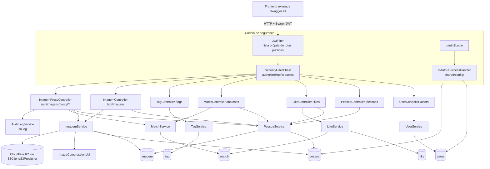

# PairUp — Retrato Técnico da Base de Código

> Documento gerado por engenharia reversa do código-fonte **no estado atual do working
> tree** (inclui mudanças ainda não commitadas sobre o commit `a9744cb`: controllers,
> services, repositories, DTOs, security, `application.yml`, `Dockerfile`,
> `docker-compose.yml`, remoção de `mvnw`/`mvnw.cmd`/`.mvn/wrapper` e de `Dockerfile.test`).
> Data desta análise: 2026-10-03 (revisão de conteúdo no mesmo dia, após a reorganização
> de pacotes). Substitui o snapshot de 2026-08-28.
>
> **Atualização de 2026-10-22 (remoção de redundâncias):** resolvidos R13 (N+1 em
> `GET /pessoas`), R18/R29 (testes isolados do `.env` pelo perfil `test`) e parte de R25
> (`definirFotoPerfil`/`findById`, parâmetro `request` de `getUserIdOrThrow`,
> `teste-upload.html`). `PessoaCompletaDTO` agora herda de `PessoaPerfilDTO`. Os números de
> linha de `PessoaService`, `ImagemService` e dos controllers citados no restante do texto
> são de 2026-10-03 e podem estar deslocados.
>
> **Estado em 2026-10-03:** pacotes reorganizados de "por camada" para "por funcionalidade"
> (ver seção 2) — a mudança só afetou declarações `package`/`import`, nenhuma lógica. Suíte
> de testes **35/35** antes e depois da reorganização (`target/surefire-reports/*.txt` de
> 2026-10-03 19:51, já com os pacotes novos, executados contra Mongo descartável em
> `localhost:27018`; ver `docs/TESTES.md`). Nenhum dos riscos R1–R28 foi corrigido no código;
> R29–R45 foram acrescentados nesta revisão (§5.5).
>
> Todas as referências `arquivo:linha` apontam para o working tree atual. Caminhos Java
> são relativos a `src/main/java/com/example/pairup/` quando não indicado o contrário.
> Onde algo **não** pôde ser confirmado por leitura de código, isso é dito explicitamente.
> Itens marcados "confirmado em execução" foram reproduzidos nesta revisão com o jar
> rodando fora da raiz do projeto (sem `.env`), contra um Mongo descartável.
>
> Documento complementar: [`docs/REFERENCIA_FUNCOES.md`](REFERENCIA_FUNCOES.md) — referência
> classe a classe e método a método.

---

## 1. Visão geral

PairUp é **apenas o backend** (API REST) de um app de paquera estilo Tinder para uma
comunidade universitária (UFS). Funcionalidades efetivamente implementadas:

- cadastro/login local (e-mail + senha, BCrypt) e login via Google OAuth2;
- perfil (`Pessoa`) separado da conta (`User`), com listagem paginada filtrável por
  `Genero`/`Interesse`;
- likes; match automático quando o like é recíproco; desfazer match;
- upload de fotos para Cloudflare R2 (S3), com compressão, e acesso via proxy autenticado
  que redireciona para URL pré-assinada (1h) — só o dono ou quem tem match ativo;
- "redes sociais" (Instagram/WhatsApp/Telegram) liberadas apenas via match — **porém não
  existe nenhum endpoint que permita gravar essas redes** (ver risco R5).

**Stack** (`pom.xml`): Spring Boot 3.2.3 / Java 21 (`pom.xml:10,21`); starters Web,
Validation, Security, OAuth2 Client, Data MongoDB (`pom.xml:41-60`); DevTools e Lombok;
springdoc-openapi 2.3.0 (`pom.xml:76-80`); jjwt 0.11.5 (`pom.xml:83-99`); AWS SDK v2 `s3`
2.25.0 via BOM (`pom.xml:26-36,102-105`); thumbnailator 0.4.20 (`pom.xml:108-112`);
spring-dotenv 4.0.0 (`pom.xml:114-118`). **Não há** `spring-boot-starter-actuator` (ver R7).

Único banco: MongoDB (coleções `users`, `pessoa`, `like`, `match`, `imagem`, `tag`).

## 2. Arquitetura

Pacotes reais (45 arquivos Java em `src/main/java`; contagem de linhas de 2026-10-03:
3.091, antes da remoção de redundâncias de 2026-10-22). A organização é **por
funcionalidade**: cada pacote agrupa entidade, repositório, service, controller e DTOs de
uma área do domínio; o que é transversal fica em `shared/`. As camadas lógicas
(controller → service → repository) continuam existindo, só que dentro de cada pacote:

| Pacote | Arquivos | Papel |
|---|---|---|
| raiz | `PairUpApplication` | `@SpringBootApplication` (`PairUpApplication.java:6-12`) |
| `user/` | `User`, `UserRepository`, `UserService`, `UserController`, `LoginRequestDTO` | conta (cadastro, login, `/users/me`) |
| `pessoa/` | `Pessoa`, `Genero`, `Interesse`, `PessoaRepository`, `PessoaService`, `PessoaController`, `PessoaPerfilDTO`, `PessoaCompletaDTO` | perfil de paquera e listagem filtrável |
| `match/` | `Like`, `Match`, `LikeRepository`, `MatchRepository`, `LikeService`, `MatchService`, `LikeController`, `MatchController`, `PessoaRedesSociaisDTO` | likes, matches e redes sociais liberadas por match |
| `imagem/` | `Imagem`, `ImagemRepository`, `ImagemService`, `AuditLogService`, `ImagemController`, `ImagemProxyController`, `ImagemUploadDTO`, `ImagemUploadResponseDTO`, `ImageCompressionUtil` | upload/compressão no R2, proxy autenticado, log de auditoria |
| `tag/` | `Tag`, `TagRepository`, `TagService`, `TagController` | tags (decorativas, ver 3.6) |
| `shared/config/` | `SecurityConfig`, `CloudflareR2Config`, `OpenAPIConfig`, `OAuth2SuccessHandler` | beans de segurança/CORS, clientes S3, Swagger, pós-login Google |
| `shared/security/` | `JwtFilter`, `JwtService`, `CustomUserDetailsService`, `SecurityUtils` | autenticação JWT stateless |
| `shared/exception/` | `GlobalExceptionHandler` | `@RestControllerAdvice` único; nenhuma exceção customizada |

Totais por papel: 7 controllers, 7 services, 6 interfaces `MongoRepository` (só queries
derivadas + 1 `@Query`), 6 documentos Mongo + 2 enums, 6 DTOs, 1 utilitário de compressão.
Dependências entre funcionalidades (imports cruzados): todas as funcionalidades importam
`shared/security` (`SecurityUtils`); `match` depende de `pessoa` (`PessoaService`/`Pessoa`);
`imagem` depende de `pessoa` e de `match` (`MatchService`, no proxy); `pessoa` depende de
`imagem` (`Imagem`, `ImagemRepository`), `tag` (`Tag`) e `match` (`PessoaRedesSociaisDTO`)
— ou seja, há ciclos `pessoa ↔ imagem` e `pessoa ↔ match` (R45); `shared/config` depende de
`user` e `pessoa`, e `shared/security` de `user`. Os testes ficam no pacote da
funcionalidade testada (`src/test/java/com/example/pairup/{user,pessoa,match,imagem,tag}/`).

**Ciclo de uma requisição autenticada**: `JwtFilter.doFilterInternal`
(`shared/security/JwtFilter.java:48-115`) checa a lista fixa `PUBLIC_ROUTES` (`:30-44`); se não
for pública exige `Authorization: Bearer`, valida o token (`JwtService`), carrega o
`User` pelo `subject` (`CustomUserDetailsService.java:22-43`) e popula o
`SecurityContextHolder` com `username = User.id`. Depois, `SecurityConfig.filterChain`
(`shared/config/SecurityConfig.java:29-79`) aplica as regras de autorização. Os controllers
obtêm o `User.id` via `SecurityUtils.getUserIdOrThrow()` (`shared/security/SecurityUtils.java:18-24`)
e, para tudo que é social (likes, matches, imagens), **traduzem para `Pessoa.id`** via
`pessoaService.findByUsuarioId(...)`.

**Dois espaços de identificador** (fundamental para entender o sistema):
- `User.id` — conta; é o *subject* do JWT (`JwtService.java:39-52`).
- `Pessoa.id` — perfil; é o que aparece em `GET /pessoas`, e o que `Like.pessoaOrigemId/
  pessoaDestinoId`, `Match.pessoaId1/pessoaId2` e `Imagem.pessoa` referenciam.
- Ligação: `Pessoa.usuarioId = User.id` (`pessoa/Pessoa.java:60`). Não há índice único
  nesse campo; a unicidade 1 User → 1 Pessoa é garantida só por checagens em código
  (`PessoaController.java:100`, `PessoaService.java:96`).

## 3. Funcionamento — fluxos ponta a ponta

### 3.1 Cadastro local e login (JWT)
1. `POST /users` (público) — `UserController.createUser` (`user/UserController.java:89-105`)
   recebe **a própria entidade `User`** como corpo (`@Valid User`), chama
   `UserService.createUser` (`user/UserService.java:20-26`): rejeita e-mail existente
   (`IllegalArgumentException` → 409), codifica a senha com BCrypt e salva. Retorna o
   `User` com `password=null`. Ver riscos R1 (mass assignment de `id`) e R14 (senha nula).
2. `POST /users/login` (público) — `UserController.login` (`:60-84`) →
   `UserService.login` (`user/UserService.java:52-61`); em sucesso gera JWT
   (`JwtService.generateToken`, HS256, expiração fixa de **15 min**, `JwtService.java:22,39-52`)
   e responde `{token, userId, email}`. Falha → 401 `{"erro": "Credenciais inválidas."}`.
3. Requisições seguintes enviam `Authorization: Bearer <token>`. Não existe endpoint de
   refresh nem logout (os métodos de refresh foram removidos nesta rodada — ver R11).
4. `GET/PUT/DELETE /users/me` (`UserController.java:36-55,110-130,135-150`). `PUT` só altera
   `nome`/`email` (`UserService.java:28-46`). `DELETE` apaga **apenas** o documento `User`
   (`UserService.java:48-50`) — a `Pessoa`, imagens, likes e matches ficam órfãos e o
   perfil continua aparecendo em `GET /pessoas` (R10).

### 3.2 Login via Google OAuth2
- Spring expõe `/oauth2/authorization/google`; configuração em
  `src/main/resources/application.yml:13-32` (`redirect-uri: ${BASE_URL}/login/oauth2/code/google`).
- Callback → `OAuth2SuccessHandler.onAuthenticationSuccess`
  (`shared/config/OAuth2SuccessHandler.java:35-71`): busca `User` por e-mail ou cria um com
  `password=null` e `provider="google"`; se não houver `Pessoa`, cria uma "básica"
  (só nome/e-mail/usuarioId/ativo — sem `genero`, `interesse`, `dataNasc`, sem checar
  idade nem termos) direto pelo repositório; gera JWT e redireciona para
  `${FRONTEND_URL}/auth/callback?token=<jwt>` (token na query string). Ver R9, R12, R31
  (depois disso `POST /pessoas` dá 409) e R32 (vínculo por e-mail não verificado).

### 3.3 Perfil (Pessoa)
- `POST /pessoas` (`pessoa/PessoaController.java:79-128`): exige
  `cienciaResponsabilidade=true` (checado **só no controller**, `:93-98`, 400), checa
  perfil duplicado (`:100-104`, 409), converte `PessoaPerfilDTO` → `Pessoa` à mão
  (`:107-116`) e chama `PessoaService.create` (`pessoa/PessoaService.java:85-102`), que
  valida maioridade (`Pessoa.isMaiorDeIdade`, `pessoa/Pessoa.java:72-75`), e-mail de perfil
  duplicado e (de novo) perfil duplicado por `usuarioId`. Erros do service viram 400.
  Retorna a **entidade** `Pessoa` (inclui `usuarioId`, redes sociais).
- `GET /pessoas/me` → `PessoaCompletaDTO` (`PessoaController.java:130-147`,
  `PessoaService.java:31-36,174-209`).
- `PUT /pessoas/me` (`PessoaController.java:149-187`): merge parcial de nome, curso,
  dataNasc, genero, interesse, descricao (feito no controller), depois
  `PessoaService.update` (`PessoaService.java:104-125`) revalida idade se a data mudou e
  copia propriedades com `BeanUtils.copyProperties`. **Tags e redes sociais nunca são
  atualizadas** (`PessoaController.java:175-176`; `PessoaPerfilDTO` nem tem campos de redes).
- `PATCH /pessoas/me/ciencia-responsabilidade` (`:189-213`) e `DELETE /pessoas/me`
  (`:215-230`, apaga só a `Pessoa`).
- `GET /pessoas?interesse=&genero=&page=&size=` (`:32-49`) →
  `PessoaService.getAllPerfisWithFilters` (`PessoaService.java:40-75`): escolhe uma das 4
  queries derivadas de `PessoaRepository` (`pessoa/PessoaRepository.java:13-19`),
  busca as imagens ativas da página em lote (`ImagemRepository.findByPessoaIdInAndAtivaTrue`)
  e monta `PessoaPerfilDTO` com `convertToPerfilDTO(pessoa, imagens)` (`:192-194`), sem
  nenhuma query extra por pessoa (R13 resolvido em 2026-10-22). O filtro é literal (não é compatibilidade) e não exclui o próprio
  usuário nem quem já foi curtido; `cienciaResponsabilidade` sai sempre `false` (R39).
- `GET /pessoas/{id}/perfil` (`:51-67`) → `PessoaPerfilDTO` por `Pessoa.id`.
- `GET /pessoas/{id}/redes-sociais` (`:69-77`) — stub que sempre responde 403.

### 3.4 Likes e match
- `POST /likes?destinoId=<Pessoa.id>` (`match/LikeController.java:59-83`):
  `User.id` do JWT → `Pessoa.id` (`PessoaService.getPessoaIdOrThrow`; sem perfil → 400);
  auto-like → 400 (`:75-78`); `LikeService.darLike` (`match/LikeService.java:89-111`):
  like já ativo → `ResponseStatusException` 400; cria/reativa o like; se existe like
  reverso ativo cria `Match` (se não houver nenhum, ativo ou inativo, entre o par —
  `:70-82`) e responde `{"match": true, "message": "É um match!"}`; senão
  `{"match": false, ...}`. Não valida se `destinoId` existe (R38).
- `GET /likes/dados` e `GET /likes/recebidos` (`LikeController.java:90-123`) — paginados
  no banco (`match/LikeRepository.java:15-17`).
- `GET /matches/meus` (`match/MatchController.java:55-68`) →
  `MatchRepository.findMeusMatchesAtivos` (`@Query` com `$and`/`$or`,
  `match/MatchRepository.java:17-18`). Retorna entidades `Match` (só IDs).
- `GET /matches/{matchId}/redes-sociais` (`MatchController.java:75-113`): 404 se o match
  não existe, 403 se inativo ou se o solicitante não participa; senão devolve
  `PessoaRedesSociaisDTO` da outra pessoa.
- `PUT /matches/desfazer/{matchId}` (`:119-148`): só participante; `MatchService.desfazerMatch`
  marca `ativo=false` (`match/MatchService.java:29-35`). Os likes continuam ativos, então
  o par não consegue "re-curtir" (o like duplicado é barrado) — não há re-match possível.

### 3.5 Upload, listagem, exclusão e proxy de imagens (R2)
- `POST /api/imagens/upload` multipart (`file`, `perfil`) —
  `imagem/ImagemController.java:27-69`: resolve `Pessoa` (sem perfil → 400),
  `ImagemService.salvarImagem` (`imagem/ImagemService.java:41-98`): valida não-vazio,
  MIME `image/*` e 5 MB (`:188-199`); comprime (`imagem/ImageCompressionUtil.java:33-43`,
  com fallback para os bytes originais); envia ao R2 com chave
  `tinder_ufs/{pessoaId}/{uuid}.{ext}` (`:60`); se `perfil=true` desmarca a foto de perfil
  anterior; persiste `Imagem` com `id` UUID e `url` = `CF_R2_PUBLIC_URL/key` se configurado,
  senão `/api/imagens/proxy/key` (`:181-186`). A resposta do controller sobrescreve `url`
  com o caminho de proxy (`ImagemController.java:53`). Sem limite de quantidade e confiando
  no MIME/extensão do cliente (R35).
- `GET /api/imagens/minhas-imagens` (`:110-145`) — imagens ativas da própria pessoa.
- `DELETE /api/imagens/{imagemId}` (`:71-108`) → `ImagemService.deletarImagem`
  (`:100-130`): 404 se não existe, 403 se não é dono, 400 se for a última imagem ativa;
  apaga do R2 (erro só logado) e faz soft-delete (`ativa=false`). Responde **200** com
  corpo (não 204).
- `GET /api/imagens/proxy/{publicId}` (`imagem/ImagemProxyController.java:32-105`):
  bloqueia path traversal por lista de substrings (`:107-125`) e regex (`:28-30,127-132`);
  404 se imagem não existe; 410 se inativa; 403 se o solicitante não tem perfil, não é o
  dono e não tem match ativo com o dono (`MatchService.existeMatchAtivo`,
  `match/MatchService.java:37-40`); registra auditoria em log e responde **302** para
  URL pré-assinada válida por 1h (`ImagemService.java:132-139`), com `Cache-Control` de 1h
  (R40). Qualquer outra exceção → 500.

### 3.6 Tags
- `GET /tags`, `GET /tags/ativas` (públicos), `POST /tags` (qualquer autenticado; aceita
  `id` no corpo e sobrescreve tags existentes, e sem `ativa` no corpo a tag nasce
  **inativa** — R33), `DELETE /tags/{id}` (exige `ROLE_ADMIN`, que ninguém tem → em runtime
  responde **302 para `/oauth2/authorization/google`**, não 403 — R15).
  `tag/TagController.java:32-102`. **Nenhum fluxo associa tags a uma `Pessoa`**
  (`Pessoa.tags` é `@DBRef List<Tag>`, `pessoa/Pessoa.java:57-58`, mas nenhum código grava
  esse campo) — a funcionalidade é decorativa.

### 3.7 Tratamento de erros
`shared/exception/GlobalExceptionHandler.java` trata `ResponseStatusException` (status/mensagem
originais, `:35-38`), `MethodArgumentNotValidException` (400 com lista de campos, `:41-55`),
`MaxUploadSizeExceededException` (413, `:58-62`) e **qualquer** `Exception` (500 genérico,
`:65-71`). Porém a maior parte dos controllers faz `try/catch` próprio e monta respostas
com formatos diferentes (ver R16).

## 4. Configuração e infraestrutura

- **Execução local**: `mvn spring-boot:run` (o Maven Wrapper `mvnw`/`mvnw.cmd`/
  `.mvn/wrapper` foi removido no working tree). Requer as variáveis abaixo e um MongoDB.
- **Docker**: `Dockerfile` multi-stage (Maven 3.9.6 + Temurin 21 → JRE 21 Alpine), usuário
  não-root (`Dockerfile:36-39`), `TZ=America/Sao_Paulo` (`:32`), HEALTHCHECK em
  `/actuator/health` (`:42-43`). `Dockerfile.test` foi removido (staged).
- **docker-compose.yml**: `mongodb` (mongo:7.0, porta 27017 exposta, DB `PAIRUP`,
  credenciais padrão `admin`/`admin123` em `:13-14`, monta `./mongo-init.js` em `:17`);
  `app` (porta 8080, `MONGODB_URI` montada a partir das credenciais em `:43`, `JAVA_OPTS`
  com `-Duser.timezone=UTC` em `:62`, volume `./logs` em `:65`, healthcheck actuator em
  `:69`); `nginx` (perfil `production`, monta `./nginx.conf` e `./ssl`, `:75-91`). Redis,
  variáveis do Google Drive e `APP_*`/`CORS_ALLOWED_ORIGINS` foram removidos nesta rodada.
- **Variáveis de ambiente lidas** (via `spring-dotenv` + placeholders):

  | Variável | Onde é lida | Observação |
  |---|---|---|
  | `MONGODB_URI` | `application.yml:6` | default do YAML `mongodb://localhost:27017/PAIRUP` (sem credenciais), **mas o `.env` atual define a variável apontando para o Mongo do Railway (produção)** — R18/R29 |
  | `JWT_SECRET` | `application.yml:48` → `JwtService.java:19-20` | obrigatória (placeholder sem default: ausente → contexto não sobe); mínimo 32 chars, mas isso só é checado na 1ª geração/validação (`JwtService.java:24-34`, R41) |
  | `GOOGLE_CLIENT_ID`/`GOOGLE_CLIENT_SECRET` | `application.yml:18-19` | obrigatórias para rodar a aplicação; nos testes o perfil `test` fixa valores |
  | `BASE_URL` | `application.yml:24` | sem default; obrigatória para rodar a aplicação (não nos testes) |
  | `FRONTEND_URL` | `OAuth2SuccessHandler.java:32` (só ali) | precisa ser **uma** URL; o compose usa duas separadas por vírgula (R9) |
  | `PORT` | `application.yml:35` | default 8080 |
  | `CF_R2_ENDPOINT`/`CF_R2_ACCESS_KEY`/`CF_R2_SECRET_KEY`/`CF_R2_BUCKET` | `application.yml:52-55` → `CloudflareR2Config`, `ImagemService` | obrigatórias (sem default) |
  | `CF_R2_PUBLIC_URL` | `application.yml:56` → `ImagemService.java:38-39` | opcional; se definida, URLs diretas do bucket vazam em respostas (R6). **Está definida no `.env` atual → R6 ativo** |
  | `CLOUDFLARE_R2_ENDPOINT`/`CLOUDFLARE_R2_PUBLIC_URL` (e demais `CLOUDFLARE_R2_*`) | binding relaxado do Spring para `cloudflare.r2.*` | não usadas pelo código diretamente; são o único jeito de sobrescrever os valores fixos do YAML de teste (`src/test/resources/application.yml:50-56`) — confirmado em execução |
  | `MONGO_ROOT_USER`/`MONGO_ROOT_PASSWORD` | `docker-compose.yml:13-14,43` | não documentadas no README |

- **Arquivos locais não versionados**: `.env` (ignorado em `.gitignore:51`). Ele **é lido**
  automaticamente pelo `spring-dotenv` em `mvn spring-boot:run` e em `mvn test` (quando
  executados a partir da raiz). Conferido nesta revisão (só nomes/hosts, sem valores): define
  12 variáveis (as do README, exceto `MONGO_ROOT_USER`/`MONGO_ROOT_PASSWORD`); `MONGODB_URI` aponta para um host `*.rlwy.net` (Mongo do
  Railway, produção); `CF_R2_PUBLIC_URL` está preenchida (R6 ativo); `FRONTEND_URL` é uma
  única URL. `tokens/StoredCredential` (ignorado, `.gitignore:36`; resquício da
  antiga integração Google Drive, nenhum código o lê — mas está no histórico do git, R43), `logs/` e `uploads/` (diretórios
  vazios de `root`; `uploads/` não é usado por código algum), `mongo-init.js` (é um
  **diretório vazio** de `root`, não um script).
- **Swagger**: `springdoc` em `/api-docs` e `/swagger-ui.html` (`application.yml:72-78`),
  metadados em `shared/config/OpenAPIConfig.java`. O caminho que funciona é
  `/swagger-ui/index.html`; `/swagger-ui.html` responde 302 para o OAuth (R8).
- **Testes**: 7 classes, 35 testes de integração (`@SpringBootTest` + MockMvc), todas com
  `@ActiveProfiles("test")`. O perfil (`src/test/resources/application-test.yml`) fixa
  valores literais: MongoDB em `localhost:27018/PAIRUP_TEST`, S3 em `localhost:9000` com
  bucket `test-bucket`, e JWT/OAuth de teste. Assim o `.env` de produção não tem efeito nos
  testes. Para mudar as portas, use `SPRING_DATA_MONGODB_URI` e
  `CLOUDFLARE_R2_ENDPOINT`/`CLOUDFLARE_R2_PUBLIC_URL`. Último resultado: **35/35** em
  2026-10-22 (`docs/TESTES.md`). Sem cobertura: OAuth2, like duplicado, `PUT /users/me`, proxy de imagem, filtros de `GET /pessoas`.

## 5. Inconsistências e riscos

### 5.0 Status dos itens do relatório anterior (2026-08-28)

| # antigo | Item | Status atual |
|---|---|---|
| 1 | Likes/matches misturavam `User.id` e `Pessoa.id` | **RESOLVIDO** — `PessoaService.getPessoaIdOrThrow`, usado por `LikeController` e `MatchController`; auto-like agora compara `Pessoa.id` (`LikeController.java:75`). Coberto por `MatchControllerTest`. Resta duplicação do helper (ver 7.2). |
| 2 | Healthcheck em `/actuator/health` sem actuator | **CONTINUA** (R7) |
| 3 | 23/35 testes falhando (auth fake, e-mails fixos, rotas erradas) | **RESOLVIDO** nos testes — 35/35 segundo `target/surefire-reports`; continua dependente de Mongo com credenciais + MinIO (R18) |
| 4 | Ninguém tem `ROLE_ADMIN`; `DELETE /tags/**` inatingível | **CONTINUA** (R15) |
| 5 | `jwt.expiration` no YAML ignorado | **RESOLVIDO por remoção** das chaves (`application.yml:47-48`); expiração continua fixa em 15 min e o refresh foi removido (R11) |
| 6 | `app.cors.*` no YAML ignorado | **PARCIAL** — chaves removidas; origens seguem hardcoded em `SecurityConfig.java:90-97` (R17) |
| 7 | Like duplicado → 500 | **RESOLVIDO** — `LikeService.java:91-93` lança `ResponseStatusException(400)`. Efeito colateral: service depende de exceção da camada web (7.2) |
| 8 | Índices únicos nunca criados | **CONTINUA** (R4) |
| 9 | `@Transactional` sem replica set | **CONTINUA, agravado no diagnóstico** (R3) |
| 10 | `PessoaPerfilDTO` sem validação | **CONTINUA** (R19) |
| 11 | `TagController.create` mascara erro como 401 | **CONTINUA** (R20) |
| 12 | Testes usam o mesmo Mongo do dev | **CONTINUA, e é pior do que o descrito antes**: o default via `.env` é o Mongo de produção (R18, R29) |
| 5.3 | Redis / Google Drive / `app.security.*` sem uso | **RESOLVIDO** — removidos do compose, do YAML e do Dockerfile (`mkdir` de `uploads`/`tokens` removido). Sobram `tokens/StoredCredential` e `uploads/` locais |
| 5.3 | Senha nula → 409 com mensagem do BCrypt | **CONTINUA** (R14) |
| 5.3 | `GET /pessoas/{id}/redes-sociais` stub 403 | **CONTINUA** (R21) |
| 6 | `HELP.md` desatualizado | **OBSOLETO** — arquivo não existe mais (e está em `.gitignore:1`) |
| — | Código morto removido nesta rodada | `JwtService.isTokenRefreshable/refreshToken`, `SecurityUtils.getCurrentRequest`, `PessoaService.getPessoaCompletaById/getPerfilComImagensById/getImagensByPessoaId/getFotoPerfilUrl`, `TagService.delete`, `UserService.getAllUsers`, métodos de repositório não usados, `ImagemUploadDTO.isValid`, `hasFotoPerfil` dos DTOs, constante `MIME_ACEITOS` |

### 5.1 Críticos

**R1. Mass assignment em `POST /users` permite sobrescrever a conta de outro usuário.**
`UserController.createUser` aceita a entidade `User` inteira (`UserController.java:96`),
incluindo `id` e `provider` (`user/User.java:15-26`, `@Data`). `UserService.createUser`
(`UserService.java:20-26`) só checa se o **e-mail novo** existe e chama
`userRepository.save(user)`; com `id` preenchido, o Spring Data trata como update e
**substitui** o documento existente. Um atacante que conheça um `User.id` (exposto em
`POST /users/login`, na entidade `Pessoa.usuarioId` retornada por `POST/PUT /pessoas` e
— via R2 — em `GET /pessoas`) troca e-mail e senha da vítima e herda a `Pessoa`, as fotos
e os matches dela. Confirmado por leitura de código (não executado). Correção: DTO de
cadastro sem `id`/`provider`.

**R2. `GET /pessoas` e `GET /pessoas/{id}/perfil` vazam dados privados de terceiros via
`imagens[].pessoa`.** `PessoaPerfilDTO.imagens` é `List<Imagem>` (entidade,
`pessoa/PessoaPerfilDTO.java:27`), e `Imagem.pessoa` é `@DBRef Pessoa` resolvido eagerly
(`imagem/Imagem.java:24-25`). O Jackson serializa a `Pessoa` completa de cada dono de
imagem: `email`, `usuarioId`, `instagram`, `whatsapp`, `telegram`, `dataNasc`... Isso anula
o controle "redes sociais só após match" (`MatchController.java:75-113`) e alimenta R1. O
próprio DTO também expõe `email` de todos os perfis listados (`PessoaService.java:217`).

**R3. `@Transactional` é no-op.** Não há `MongoTransactionManager` (nem nenhum
`TransactionManager`) declarado — `grep TransactionManager src/main` não retorna nada, e o
Spring Boot não cria um para MongoDB automaticamente. Logo `@Transactional` em
`LikeService.java:89`, `PessoaService.java:31,40,85,104,127` e
`ImagemService.java:41,100,141,147,153,158` não tem efeito. O comentário de
`LikeService.java:84-88` ("torna verificar+criar atômico") é falso. Mesmo com o bean, o
Mongo do compose é standalone (sem replica set), onde transações não funcionam.

**R4. Índices únicos não são criados.** `spring.data.mongodb.auto-index-creation` não está
definido (ausente em `application.yml`, no YAML de teste e no compose; o default no Boot 3 é
`false`), e `mongo-init.js` é um diretório vazio. Portanto `User.email`
(`user/User.java:22`), `Pessoa.email` (`pessoa/Pessoa.java:35`), `Imagem.publicId`
(`imagem/Imagem.java:31`) e o composto `unique_like` (`match/Like.java:11-13`) **não são
garantidos pelo banco**. Somado a R3: likes/matches/usuários duplicados por concorrência;
`UserService.updateUser` nunca recebe `DuplicateKeyException` (`UserService.java:41`), então
`PUT /users/me` permite e-mail duplicado e, depois, `findByEmail` no login lança
`IncorrectResultSizeDataAccessException` → 500.

### 5.2 Altos

**R5. Redes sociais não podem ser cadastradas por nenhum endpoint.** Nenhum código chama
`Pessoa.setInstagram/setWhatsapp/setTelegram` (só getters em `PessoaService.java:193-195,247-249`);
`PessoaPerfilDTO` não tem esses campos. `GET /matches/{id}/redes-sociais` sempre devolve
`null` nos três campos, salvo dados inseridos direto no banco.

**R6. "Nunca a URL direta do bucket" depende de configuração — e está ativo.** O `.env`
atual define `CF_R2_PUBLIC_URL`. Se `CF_R2_PUBLIC_URL`
estiver definida, `Imagem.url` = URL pública do bucket (`ImagemService.java:181-184`), e ela
é devolvida em `fotoPerfilUrl`/`imagens[].url` por `GET /pessoas`, `/pessoas/{id}/perfil` e
`/pessoas/me` (`PessoaService.java:76,179,239`), contornando o proxy. Só o upload e
`minhas-imagens` reescrevem para o proxy (`ImagemController.java:53,128`).

**R7. Healthcheck do container sempre falha.** `Dockerfile:42-43` e
`docker-compose.yml:69` chamam `/actuator/health`, mas não há actuator no `pom.xml`; o bloco
`management:` (`application.yml:80-87`) é configuração morta. Além disso o `JwtFilter`
responderia 401 sem token. Com o handler genérico, um GET autenticado nessa rota daria 500
(ver R16).

**R8. Swagger UI em `/swagger-ui.html` está bloqueado (302 para o OAuth).** São duas
listas de rotas públicas com regras de comparação diferentes:
- O `JwtFilter` compara **por prefixo**: para padrões terminados em `/**` ele remove os 3
  últimos caracteres e usa `startsWith` (`JwtFilter.java:117-133`). `GET /swagger-ui/**`
  (`:36`) vira o prefixo `/swagger-ui`, e `"/swagger-ui.html".startsWith("/swagger-ui")` é
  verdadeiro — então o filtro **deixa a requisição passar** sem exigir token. (O mesmo
  efeito colateral vale para qualquer caminho que comece com `/oauth2`, `/api-docs`,
  `/v3/api-docs`, `/login/oauth2`, mesmo sem a barra.)
- Quem bloqueia é o `SecurityConfig`: `"/swagger-ui/**"` (`SecurityConfig.java:45`) é um
  padrão de caminho do Spring e **não** casa com `/swagger-ui.html`, que cai em
  `anyRequest().authenticated()` (`:69`). Como a requisição está anônima, o Spring Security
  chama o entry point do `oauth2Login` (`:72-74`), que responde **302 para
  `/oauth2/authorization/google`** (com `X-Requested-With: XMLHttpRequest` o redirect é para
  `/login`).
Confirmado em execução: `/swagger-ui.html` → `302 Location: /oauth2/authorization/google`;
`/swagger-ui/index.html` → 200; `/api-docs` → 200. O caminho configurado em
`application.yml:77` e antes citado no README não funciona; o acesso real é
`/swagger-ui/index.html`.

**R9. `FRONTEND_URL` do compose quebra o redirect do OAuth.** Default do compose:
`http://localhost:3000,http://localhost:5173` (`docker-compose.yml:59`). O
`OAuth2SuccessHandler` usa o valor como URL única (`OAuth2SuccessHandler.java:32,67-68`) →
redireciona para `http://localhost:3000,http://localhost:5173/auth/callback?token=...`.
O valor parece herdado da antiga variável de CORS.

**R10. Exclusões deixam órfãos e perfis "fantasmas".** `DELETE /users/me` apaga só o `User`
(`UserService.java:48-50`); a `Pessoa` continua `ativo=true` e listada em `GET /pessoas`.
`DELETE /pessoas/me` apaga só a `Pessoa` (`PessoaService.java:164-170`): imagens (inclusive
objetos no R2), likes e matches ficam órfãos.

**R11. Sessão expira em 15 min sem refresh.** `EXPIRATION_MS` fixo (`JwtService.java:22`);
os métodos de refresh foram removidos e não há endpoint para renovar. A cada 15 min o
cliente precisa refazer login (ou o fluxo Google).

**R12. OAuth cria `Pessoa` incompleta e fora das regras.** `OAuth2SuccessHandler.java:54-62`
grava direto no repositório uma `Pessoa` sem `genero`/`interesse`/`dataNasc` (violando os
`@NotNull` da entidade), sem checar idade nem termos, `ativo=true` → aparece em
`GET /pessoas` imediatamente. Também coloca o JWT na query string do redirect (`:68`), que
fica em histórico/logs.

### 5.3 Médios

**R13. ~~N+1 não resolvido em `GET /pessoas`.~~ Resolvido em 2026-10-22:** o conversor
recebe as imagens já buscadas em lote e não faz mais uma query por pessoa. Continua valendo
que cada `Imagem` resolve seu `@DBRef`
individualmente, e o `groupingBy(img -> img.getPessoa().getId())` (`:66`) depende disso.

**R14. Cadastro sem senha → 409 com mensagem interna.** `User.password` não tem validação
(`user/User.java:25`); `passwordEncoder.encode(null)` lança `IllegalArgumentException`
("rawPassword cannot be null"), que `UserController.java:101-104` converte em 409. `LoginRequestDTO`
também não tem validações (`user/LoginRequestDTO.java:5-9`), apesar do `@Valid`.

**R15. `ROLE_ADMIN` inexistente, e o "403" vira 302.** `CustomUserDetailsService.java:37`
atribui `Collections.emptyList()`; `SecurityConfig.java:53` exige `hasRole("ADMIN")`, então
`TagController.delete` (`:84-102`) é código morto. Em runtime, porém, o cliente **não recebe
403**: o `AccessDeniedHandler` padrão faz `response.sendError(403)`, o container faz um
*dispatch* interno para `/error`, e esse dispatch passa de novo pela cadeia de segurança.
`/error` não está liberado (cai em `anyRequest().authenticated()`, `SecurityConfig.java:69`) e
o `JwtFilter`, por ser `OncePerRequestFilter`, não roda de novo no dispatch de erro — o
`SecurityContext` montado por ele não foi salvo em nenhum repositório, então a requisição de
`/error` é anônima e cai no entry point do `oauth2Login`: **302 para
`/oauth2/authorization/google`**. Confirmado em execução (`DELETE /tags/1` com token válido →
302) e em `docs/TESTES.md` (item B). O teste `TagControllerTest.testDeleteTagDeveSerBloqueado`
espera 403 e passa porque o MockMvc não executa o dispatch de `/error`.
**Isso afeta qualquer `sendError` do Spring** em rota autenticada (negação de acesso,
erros que o Spring resolve com `sendError` em vez de `ResponseEntity`): o status real é
trocado por um redirect para o Google. Os 4xx devolvidos via `ResponseEntity` pelos
controllers não são afetados. Ao mesmo tempo qualquer usuário autenticado cria tags
(`SecurityConfig.java:52`) — modelo de autorização incoerente (ver também R33).

**R16. Tratamento de erro fragmentado e handler genérico agressivo.**
Quatro formatos de erro coexistem: `{"erro": ...}` (`UserController`, `TagController`,
`JwtFilter.java:143`, `GlobalExceptionHandler`), `{"error": ...}` (`PessoaController.java:97,103,126,185,211`),
texto puro (`MatchController.java:95,102,142,147`) e `ImagemUploadResponseDTO{sucesso,mensagem}`
(`ImagemController`). O `@ExceptionHandler(Exception.class)` (`GlobalExceptionHandler.java:65-71`)
captura também exceções que o Spring normalmente mapeia para 4xx — parâmetro ausente
(`POST /likes` sem `destinoId`), enum inválido (`GET /pessoas?genero=X`), JSON malformado,
método não suportado e, no Spring 6.1, `NoResourceFoundException` de rota inexistente —
devolvendo **500**. (Comportamento padrão do Spring MVC; não executado aqui.) Os
`catch (Exception e)` de `ImagemController.java:64-67,103-106` devolvem `e.getMessage()` ao
cliente, contrariando a política declarada em `GlobalExceptionHandler.java:19-28`; e
`server.error.include-message: always` (`application.yml:37`) idem.

**R17. CORS hardcoded.** 6 origens fixas, incluindo domínios Vercel/Railway de produção e de
preview (`SecurityConfig.java:90-97`). Trocar de domínio exige recompilar.

**R18. ~~Testes dependem de infraestrutura externa, e o default efetivo é produção.~~**
**Resolvido em 2026-10-22** pelo perfil `test` (`src/test/resources/application-test.yml`,
valores literais, `@ActiveProfiles("test")` em todas as classes). Os testes ainda precisam
de um Mongo (`localhost:27018`) e de um S3 (`localhost:9000`) locais, sem Testcontainers.
Texto original: `src/test/resources/application.yml:6` usa `${MONGODB_URI:mongodb://localhost:27017/PAIRUP}`,
mas o default do YAML quase nunca vale: o `spring-dotenv` carrega o `.env` da raiz, e o
`.env` atual define `MONGODB_URI` apontando para o **Mongo do Railway (produção)**. Ou seja,
um `mvn test` sem sobrescrever `MONGODB_URI` grava usuários/perfis/likes de teste em
produção (detalhe em R29). O S3 é fixo em `localhost:9000`, bucket `test-bucket`
(`:50-56`) — as `CF_R2_*` não têm efeito; só `CLOUDFLARE_R2_*` sobrescrevem. As
`GOOGLE_*`, `BASE_URL` e `JWT_SECRET` também são exigidas (placeholders sem default). Sem
Testcontainers e sem limpeza: os dados acumulam no banco usado.

**R19. Validação de entrada divergente entre entidade e DTO.** `Pessoa` tem `@NotBlank`/
`@NotNull`/`@Email`/`@Past` (`pessoa/Pessoa.java:26-44`), mas `PessoaPerfilDTO` não tem
nenhuma anotação (`pessoa/PessoaPerfilDTO.java:10-29`) — `@Valid` em `PessoaController.java:88,157`
não valida nada. `ImagemUploadDTO` também não tem `@NotNull` em `file`. `@NotBlank` em
`@RequestParam destinoId` (`LikeController.java:68`) sem `@Validated` na classe: no Spring 6.1
a validação embutida de método pode disparar `HandlerMethodValidationException`, que cairia no
500 genérico — não confirmado em execução.

**R20. `TagController.create` mascara qualquer erro como 401** (`TagController.java:63-77`).

### 5.4 Baixos

- **R21.** `GET /pessoas/{id}/redes-sociais` é stub que sempre retorna 403 e ignora `id`
  (`PessoaController.java:69-77`), mas aparece no Swagger como rota.
- **R22.** Fuso horário conflitante: `TZ=America/Sao_Paulo` (`Dockerfile:32`) vs
  `-Duser.timezone=UTC` (`docker-compose.yml:62`, que também sobrescreve o `JAVA_OPTS` do
  Dockerfile). Afeta `LocalDate.now()` em `Pessoa.isMaiorDeIdade` e `Imagem.dataUpload`.
- **R23.** Compose com resíduos: `args: JAR_FILE=build/libs/*.jar` (`docker-compose.yml:33`,
  caminho de Gradle; o Dockerfile não declara `ARG`), `nginx` montando `./nginx.conf` e
  `./ssl` que não existem (`:84-85`), `./mongo-init.js` que é diretório (`:17`), credenciais
  padrão `admin/admin123` versionadas (`:13-14`), porta 27017 exposta ao host (`:10`), volume
  `./logs` sem nenhum appender de arquivo configurado (`application.yml:64-70`).
- **R24.** Nomenclatura legada `tinder_ufs/` no prefixo das chaves R2
  (`ImagemService.java:60`, `ImagemProxyController.java:131`, `imagem/Imagem.java:32`) após o
  rename para PairUp; o regex alternativo de `ImagemProxyController.java:131` é redundante
  (o padrão principal já aceita essas chaves).
- **R25.** Código sem uso. Removidos em 2026-10-22: `ImagemService.definirFotoPerfil` e
  `ImagemService.findById`, o parâmetro `request` de `SecurityUtils.getUserIdOrThrow` (e os
  `HttpServletRequest` que os controllers só repassavam) e `static/teste-upload.html`.
  O restante abaixo é do texto original: `PessoaRepository.findByEmail`
  (`pessoa/PessoaRepository.java:23`); construtor `ImagemUploadResponseDTO(String,String)`
  (`imagem/ImagemUploadResponseDTO.java:19-23`); `JwtService.getExpirationDate` é público mas só
  usado internamente; `AuditLogService` só escreve log (não persiste).
- **R26.** Métodos auxiliares de DTO viram campos JSON: `PessoaCompletaDTO.getQuantidadeGaleria`,
  `getImagensGaleria`, `isPerfilCompleto` (`pessoa/PessoaCompletaDTO.java:28-52`) e
  `Pessoa.isMaiorDeIdade` (`pessoa/Pessoa.java:72`) aparecem como `quantidadeGaleria`,
  `imagensGaleria`, `perfilCompleto`, `maiorDeIdade` nas respostas — não documentado.
- **R27.** Like nunca é desativado (`setAtivo(false)` só existe para `Match`,
  `MatchService.java:32`); o ramo de reativação em `LikeService.criarOuAtivarLike`
  (`LikeService.java:55-60`) é inalcançável na prática.
- **R28.** `JwtFilter` parseia o mesmo token até 4 vezes por requisição
  (`isTokenValid`, `extractUserId`, `isTokenValid(token, ud)` → `extractUserId` +
  `getExpirationDate`) e consulta o `User` no banco a cada requisição.

### 5.5 Riscos adicionados em 2026-10-03 (R29–R45)

Numerados na ordem em que foram levantados (não por gravidade). Por gravidade:
**críticos** R29, R32; **altos** R30, R31, R35, R43; **médios** R33, R34, R36, R37, R38,
R39, R40, R41; **baixos** R42, R44, R45.

**R29. ~~[Crítico] `mvn test` grava no MongoDB de produção.~~ Resolvido em 2026-10-22** pelo
perfil `test` (ver R18). Verificado: suíte rodada **sem** sobrescrever `MONGODB_URI`, com o
`.env` presente → 72 conexões a `localhost:27018`, 0 a `rlwy`. Risco residual: uma classe
de teste nova sem `@ActiveProfiles("test")` volta a ler o `.env`. Texto original: O `spring-dotenv`
(`pom.xml:114-118`) carrega o `.env` da raiz também na execução dos testes;
`src/test/resources/application.yml:6` usa `${MONGODB_URI:...}`, e o `.env` atual aponta
`MONGODB_URI` para o Mongo do Railway. Os testes criam usuários, perfis, likes, matches e
tags e não limpam nada (comentário em `src/test/java/com/example/pairup/imagem/ImagemControllerTest.java:30-33`).
Quem rodar `mvn test` na raiz sem sobrescrever `MONGODB_URI` polui (e pode corromper, via
R4/R37) a base de produção. Mitigação documentada em `README.md#testes` e `docs/TESTES.md`;
correção real: perfil de teste com URI fixa ou Testcontainers.

**R30. [Alto] Contradição de produto entre o feed e o proxy de fotos.** `GET /pessoas`
devolve as imagens de todos os perfis listados (`PessoaService.java:63-77`), mas o proxy só
libera a foto para o dono ou para quem já tem match ativo com o dono
(`ImagemProxyController.java:84-90`). Sem `CF_R2_PUBLIC_URL`, as URLs do feed são de proxy
(`ImagemService.java:181-186`) → quem navega no feed recebe 403 em todas as fotos de quem
ainda não deu match, ou seja, não vê ninguém antes de curtir. Com `CF_R2_PUBLIC_URL` (o caso
atual), as URLs do feed são públicas e o proxy é irrelevante (R6). Nenhum dos dois modos
implementa "fotos visíveis no feed, mas protegidas"; a política precisa ser decidida.

**R31. [Alto] Login Google cria `Pessoa` incompleta e `POST /pessoas` passa a responder
409.** `OAuth2SuccessHandler.java:53-62` grava uma `Pessoa` só com nome, e-mail,
`usuarioId` e `ativo=true` (complementa R12). Depois disso, `POST /pessoas` encontra o perfil
(`PessoaController.java:100-104`) e responde **409 "Perfil já existe"** — o fluxo normal de
cadastro de perfil fica inacessível para quem entrou pelo Google. O único caminho é
`PUT /pessoas/me` (`:149-187`) + `PATCH /pessoas/me/ciencia-responsabilidade` (`:189-213`),
o que não está documentado para o frontend; enquanto isso o perfil incompleto já aparece em
`GET /pessoas`.

**R32. [Crítico] Conta Google é vinculada à conta local só pelo e-mail, sem verificação.**
`OAuth2SuccessHandler.java:46-50` usa `userRepository.findByEmail(email)` e, se achar, emite
o JWT dessa conta. `POST /users` (`UserController.java:96`, `UserService.java:20-26`) não
verifica posse do e-mail. Um atacante pode **pré-registrar** uma conta local com o e-mail
da vítima e uma senha que ele conhece; quando a vítima entrar com Google, ela passa a usar
essa mesma conta (perfil, fotos, matches), à qual o atacante continua tendo acesso pela
senha. O handler também não confere o atributo `email_verified` do Google. Confirmado por
leitura de código; não executado (exige login Google real).

**R33. [Médio] `POST /tags` aceita `id` e sobrescreve tags; `ativa` some se omitida.**
`TagController.create` recebe a entidade `Tag` (`TagController.java:59-60`) e
`TagService.create` faz `save` (`TagService.java:18-20`): com `id` existente, o documento é
substituído — qualquer usuário autenticado altera qualquer tag. Além disso, o Jackson
desserializa `Tag` pelo construtor de 4 argumentos (`Tag.java:20-25`, não há construtor
vazio), então um corpo sem `ativa` cria a tag com `ativa=false` (o default `true` de
`Tag.java:18` é ignorado) e ela não aparece em `GET /tags/ativas`. Ambos confirmados em
execução.

**R34. [Médio] `catch (Exception) → 401` transforma erros de negócio em "não autenticado".**
`UserController.java:49-54` (`GET /users/me`), `:126-129` (`PUT /users/me`), `:147-149`
(`DELETE /users/me`) e `TagController.java:73-77` (`POST /tags`) respondem 401 para
**qualquer** exceção. Em `PUT /users/me`, o `UserService.updateUser` converte
`DuplicateKeyException` em `IllegalArgumentException("Email já cadastrado por outro
usuário")` (`UserService.java:39-43`), que o controller transforma em **401 "Usuário não
autenticado"**. Hoje, sem índice único (R4), nem isso acontece: trocar o e-mail para o de
outra conta responde **200** e duplica o e-mail (confirmado em execução). Quando R4 for
corrigido, o sintoma vira 401 — o frontend provavelmente vai deslogar o usuário.

**R35. [Alto] Upload sem limite de quantidade, confiando no cliente.** `ImagemService.salvarImagem`
(`ImagemService.java:41-98`) não limita quantas imagens uma pessoa pode ter;
`validarArquivo` (`:188-199`) só olha o `Content-Type` **declarado** pelo cliente; a extensão
da chave vem do nome do arquivo enviado (`:59-60`, `:201-204`) e o `contentType` gravado no
R2 é o do cliente (`:61`); se a compressão falhar, **os bytes originais são enviados mesmo
assim** (`:51-57`). Ex.: um SVG com script declarado como `image/svg+xml` passa na validação,
falha na compressão e vai para o bucket com esse content-type — com `CF_R2_PUBLIC_URL`
(R6) ele é servido do domínio público do bucket (XSS armazenado nesse domínio; inferido,
não executado). `docs/TESTES.md` (item E) confirmou o aceite de um arquivo texto com
`Content-Type: image/png`.

**R36. [Médio] Sem rate limit nem bloqueio no login.** `POST /users/login`
(`UserController.java:60-84`) não tem limitação de tentativas; não há nenhuma dependência ou
filtro de rate limiting no projeto (`grep` por `rate`/`bucket4j` em `src/main` não encontra
nada; as antigas chaves `app.security.rate-limit.*` nunca foram implementadas). Força bruta
de senha só é freada pelo custo do BCrypt.

**R37. [Médio] `Match` não declara índice único.** `match/Match.java:7-19` não tem
`@Indexed`/`@CompoundIndex` (diferente de `Like`, que ao menos declara `unique_like`).
`LikeService.criarMatchSeNaoExistir` faz "verifica e insere" (`LikeService.java:70-82`) sem
atomicidade (R3); dois likes recíprocos simultâneos podem gerar dois `Match` para o mesmo
par, e a partir daí `findByPessoaId1AndPessoaId2` (`MatchRepository.java:20`, `Optional`)
lança `IncorrectResultSizeDataAccessException` → 500. Mesmo com `auto-index-creation` ligado,
não haveria índice para criar.

**R38. [Médio] `destinoId` do like não é validado.** `LikeController.darLike`
(`LikeController.java:66-82`) e `LikeService.darLike` (`LikeService.java:89-111`) não checam
se existe uma `Pessoa` com esse id (nem se está ativa). Likes para `User.id`, ids
inexistentes ou perfis apagados respondem 200 e gravam `Like` órfãos (confirmado em
`docs/TESTES.md`, item D).

**R39. [Médio] `GET /pessoas` devolve `cienciaResponsabilidade=false` para todos e inclui o
próprio usuário.** `PessoaService.convertToPerfilDTO` (`PessoaService.java:192-194`) não
copia `cienciaResponsabilidade`, então o campo do `PessoaPerfilDTO` (`PessoaPerfilDTO.java:24`)
fica sempre no default `false`, também em `GET /pessoas/{id}/perfil`. E
`PessoaController.getAll` descarta o `userId` (`PessoaController.java:44`): a listagem não
exclui o próprio solicitante, nem perfis já curtidos/com match. Confirmado em
`docs/TESTES.md` (item F).

**R40. [Médio] Acesso a fotos sobrevive até 1h ao fim do match.** O proxy responde 302 com
`Cache-Control: private, max-age=3600` (`ImagemProxyController.java:96-99`) para uma URL
pré-assinada válida por 1h (`ImagemService.java:132-139`). Depois de `PUT
/matches/desfazer/{id}`, o navegador do ex-match reutiliza o redirect em cache e a URL
pré-assinada continua válida — o acesso só termina quando ambos expiram. Qualquer URL
pré-assinada vazada também funciona sem autenticação nesse período.

**R41. [Médio] Tamanho do `JWT_SECRET` só é validado no primeiro uso.** `JwtService.getKey`
(`JwtService.java:24-34`) checa `< 32` caracteres a cada chamada, mas não há
`@PostConstruct`: com um segredo curto a aplicação sobe normalmente e falha só no primeiro
login (`IllegalStateException` → 500 pelo handler genérico, já que
`UserController.java:79` só captura `BadCredentialsException`) ou em qualquer requisição com
token (→ 401 "Token inválido ou expirado" pelo `catch` do `JwtFilter`). Ausência total da
variável, por outro lado, impede o startup (placeholder sem default).

**R42. [Baixo] `S3Presigner` sem path-style, diferente do `S3Client`.**
`CloudflareR2Config.java:27-38` liga `pathStyleAccessEnabled(true)` no `S3Client`, mas o
`S3Presigner` (`:40-48`) não, então as URLs pré-assinadas saem em estilo virtual-host
(`http://<bucket>.<host>/...`). Com MinIO local padrão isso dá `400 InvalidBucketName`
(`docs/TESTES.md`, item G); no R2 real o estilo virtual-host deve funcionar (não verificado).

**R43. [Alto] `tokens/StoredCredential` está no histórico do git.** O arquivo (credencial
OAuth do antigo Google Drive, 1.162 bytes) foi commitado em `bc1b363` ("Atualização do
paruip com token"). Hoje está no `.gitignore` (`:36-37`) e não é mais rastreado, mas
continua recuperável do histórico por quem tiver o repositório. O token deve ser
**revogado** na conta Google; reescrever o histórico é opcional.

**R44. [Baixo] Campo `_class` de documentos antigos aponta para pacotes que não existem
mais.** O Spring Data grava o nome completo da classe em `_class` em cada documento. Dados
criados antes de `a9744cb` têm `com.example.Tinder_ufs.models.*`; os criados entre `a9744cb`
e a reorganização de 2026-10-03, `com.example.pairup.models.*`. Nenhuma classe usa
`@TypeAlias`. Pelo comportamento conhecido do `DefaultMongoTypeMapper`, um alias que não
resolve para classe é ignorado e o tipo declarado é usado, então a leitura **deve**
funcionar — mas isso **não foi testado** contra dados reais de produção. Vale testar a
leitura de um dump antes do deploy (ou migrar `_class` com `updateMany`).

**R45. [Baixo] Ciclos de import entre funcionalidades.** `pessoa` importa `imagem`
(`PessoaService.java:4,6`, `PessoaPerfilDTO.java:3`, `PessoaCompletaDTO.java:3`) e `imagem`
importa `pessoa` (`Imagem.java:3`, `ImagemService.java:3-4`, `ImagemController.java:3,5`,
`ImagemProxyController.java:3,6`); `pessoa` importa `match` (`PessoaService.java:3`,
`PessoaRedesSociaisDTO`) e `match` importa `pessoa` (`LikeController.java:3,5`,
`MatchController.java:3,5`). Não há ciclo de beans (compila e sobe), mas os pacotes por
funcionalidade não são independentes — não dá para extrair um módulo sem levar os outros.
`PessoaRedesSociaisDTO` está em `match/` embora seja montado em `PessoaService`.

### 5.6 Correspondência das referências antigas citadas no código

Comentários em `src/` ainda citam a numeração do relatório de 2026-08-28. Correspondência
com a numeração atual (os comentários não foram alterados; `src/` fora do escopo desta
revisão):

| Referência no código | Onde | Corresponde hoje a |
|---|---|---|
| "ARQUITETURA.md, item crítico 1" | `match/LikeController.java:38`, `match/MatchController.java:39`, `src/test/.../match/LikeControllerTest.java:65`, `src/test/.../match/MatchControllerTest.java:68` | item 1 antigo (mistura `User.id`/`Pessoa.id`), **resolvido** — §5.0, linha "1"; não tem número R. O conceito está em §2 ("Dois espaços de identificador") |
| "ARQUITETURA.md, item 4" | `src/test/.../tag/TagControllerTest.java:110` | **R15** (o comentário diz que o Spring responde 403; em runtime é 302) |
| "ARQUITETURA.md, item 12" | `src/test/.../imagem/ImagemControllerTest.java:31` | **R18** e **R29** |
| "item \"Endpoint stub que sempre retorna 403\"" | `src/test/.../pessoa/PessoaControllerTest.java:209-210` | **R21** |

## 6. Avaliação de documentação e modularidade

### 6.1 Documentação no código

Cobertura aproximada (blocos Javadoc `/**` contados por arquivo; métodos públicos escritos à
mão, sem contar getters/setters do Lombok):

| Papel (pacotes) | Javadoc de classe | Métodos públicos documentados | Swagger (`@Operation`) | Nota |
|---|---|---|---|---|
| `shared/config/` | 0/4 | 0/5 | — | 2/10 |
| `shared/security/` | 0/4 | 5/9 (só `JwtService`) | — | 4/10 |
| controllers (`*Controller`) | 0/7 | 15/27 (`User`, `Tag`, `Like`, `Match`); 0 em `Pessoa`, `Imagem`, `ImagemProxy` | 5/7 controllers; **nenhuma** em `ImagemController`/`ImagemProxyController` | 5/10 |
| services (`*Service`) | 0/7 | ~6/34 (`LikeService`, 1 em `MatchService`, 2 triviais em `PessoaService`); 0 em `ImagemService`, `UserService`, `TagService`, `AuditLogService` | — | 2/10 |
| repositórios (`*Repository`) | 0/6 | 2/22 | — | 3/10 (queries derivadas são autoexplicativas) |
| entidades/enums e DTOs | 0/14 | 0 | nenhum `@Schema` | 1/10 |
| `shared/exception/` | 1/1 | 4/4 | — | 9/10 |
| `imagem/ImageCompressionUtil` | 0/1 | 2/2 + campos | — | 8/10 |

Total: ~41 blocos Javadoc em 45 arquivos; aproximadamente **25-30% dos métodos públicos**
têm alguma documentação. Qualidade:
- **Bons exemplos**: `GlobalExceptionHandler.java:19-28` (política explícita),
  `ImageCompressionUtil.java:14-48` (parâmetros e retorno), `LikeController.java:35-42` e
  `MatchController.java:34-40` (explicam o *porquê* da tradução de IDs).
- **Comentários de changelog no lugar de documentação**: muitos comentários narram correções
  ("✅ CORRIGIDO", "CORREÇÃO CRÍTICA", "MUDOU PARA DTO") em vez de descrever comportamento —
  `UserController.java:22,34,50`, `TagController.java:18,50,64,74,90,99,104`,
  `SecurityConfig.java:39-68`, `JwtFilter.java:29,65-66`, `PessoaController.java:88,157,175`,
  `PessoaService.java:231,235`, `MatchService.java:14-20`. Alguns são instruções esquecidas:
  `PessoaPerfilDTO.java:24` ("Adicione se não tiver"), `:26` ("ADICIONE ESTES CAMPOS"),
  `TagController.java:104` ("Adicionar logger se não existir"), `Pessoa.java:44,50`
  ("ANTIGA sexualidade", "NOVO CAMPO"). Comentários que referenciam `docs/ARQUITETURA.md`
  por número antigo ("item crítico 1", "item 4", "item 12") ficaram órfãos com a numeração
  R1–Rn — ver a tabela de correspondência em §5.6.
- **Comentários enganosos**: `LikeService.java:84-88` (atomicidade que não existe, R3);
  `PessoaService.java:58` ("evita N+1", R13); `JwtService.java:30` (mensagem de erro cita
  "Railway"); `TagController.java:82` ("Retorna 403 explícito" — nunca é alcançado, R15).
- **Swagger**: as anotações `@ApiResponse` de `PessoaController` dizem 409 para perfil
  duplicado mas um perfil duplicado detectado pelo service vira 400; as de `TagController.delete`
  descrevem um corpo JSON que o cliente nunca recebe. Upload/proxy de imagens não têm
  nenhuma descrição de contrato.

**Veredito documentação: insuficiente** (≈3/10). Há documentação boa em pontos isolados, mas
services, entidades, DTOs e `shared/config/` estão praticamente sem documentação, e boa parte dos
comentários existentes é histórico de correção, não especificação.

### 6.2 Modularidade

| Papel (pacotes) | Nota | Achados principais |
|---|---|---|
| controllers (`*Controller`) | 4/10 | Lógica de negócio e mapeamento no controller: `PessoaController.create` (validação de termos, checagem de duplicidade, DTO→entidade, `:93-116`) e `updateMe` (merge parcial, `:168-173`); checagem de participação no match duplicada em `MatchController.java:99-103` e `:139-143`; `resolvePessoaId` copiado em `LikeController.java:43-50` e `MatchController.java:41-48`, e o mesmo padrão "findByUsuarioId → null → 400/403" repetido em `ImagemController.java:35-39,79-83,115-118` e `ImagemProxyController.java:74-77`; montagem de URL de proxy em 3 lugares (`ImagemController.java:53,128`, `ImagemService.java:185`); `try/catch` com formatos de erro diferentes em cada classe (R16). |
| services (`*Service`) | 5/10 | `PessoaService` (257 linhas) mistura CRUD, filtros e 3 conversores DTO; `LikeService` lança `ResponseStatusException` (dependência da camada web, `LikeService.java:9,92`) e devolve `Map<String,Object>`; contrato de erro inconsistente (`null` em `UserService.findById`, `PessoaService.findById`; `RuntimeException` genérica em `PessoaService`; `IllegalArgumentException`/`SecurityException`/`IllegalStateException` em `ImagemService`); `TagService`/`MatchService`/`AuditLogService` são repasses finos. `ImagemService` usa `PessoaRepository` direto em vez de `PessoaService`. |
| `shared/config/` | 5/10 | `OAuth2SuccessHandler` é lógica de negócio (provisiona `User` e `Pessoa`) acessando repositórios diretamente, fora dos services e duplicando regras de criação de perfil sem as validações; `SecurityConfig` mistura autorização e CORS hardcoded. |
| `shared/security/` | 6/10 | Responsabilidades bem separadas (filtro, serviço JWT, user details, util), mas a lista de rotas públicas é mantida em **dois lugares** com regras diferentes (`JwtFilter.java:30-44` por método+caminho vs `SecurityConfig.java:40-51` só por caminho); `SecurityUtils` é estático e recebe `request` inútil. |
| DTOs (`*DTO`) | 4/10 | DTOs embutem entidades (`List<Imagem>` em `PessoaPerfilDTO`/`PessoaCompletaDTO`, causa de R2); `PessoaPerfilDTO` é usado como entrada **e** saída (campos `id`, `imagens`, `fotoPerfilUrl`, `tags` são ignorados na entrada); `User` e `Tag` (entidades) são usados diretamente como `@RequestBody` (causa de R1); `Pessoa`/`Match`/`Like`/`Tag` são retornados crus. |
| entidades | 6/10 | Entidades simples com Lombok; relação `Imagem → Pessoa` por `@DBRef` mas `Like`/`Match` por `String` (dois estilos); `Pessoa.tags` nunca é gravado; `Imagem.id` é UUID gerado à mão (`ImagemService.java:93`) enquanto os demais usam ObjectId. |
| repositórios (`*Repository`) | 8/10 | Enxutos, só queries derivadas + 1 `@Query` correta; 1 método sem uso. |
| `shared/exception/` | 5/10 | Bem documentado, mas pouco usado (controllers capturam antes) e sem exceções de domínio; o catch-all transforma 4xx do framework em 500. |
| `imagem/ImageCompressionUtil` | 8/10 | `ImageCompressionUtil` coeso, configurável e documentado. |

Convenções mistas (detalhe em `.claude/skills/padronizacao-codigo`): inglês/português
(`User`/`users`/`/users` vs `Pessoa`/`pessoa`/`/pessoas`; `getAll`/`create` vs
`darLike`/`listarLikesDados`); logger por `@Slf4j` (`ImagemController`, `ImagemService`,
`PessoaService`, `AuditLogService`) vs `LoggerFactory` manual (demais) — em `TagController.java:105`
declarado no fim da classe com nome totalmente qualificado; injeção via `@AllArgsConstructor`,
`@RequiredArgsConstructor` e `@Autowired` em campo (`SecurityConfig.java:23-27`,
`OAuth2SuccessHandler.java:23-30`); `@RequestMapping("likes")`/`("matches")` sem barra vs
`("/users")`.

**Veredito modularidade: razoável na estrutura, fraca na disciplina** (≈5/10). A separação em
camadas (hoje dentro de pacotes por funcionalidade) é respeitada no sentido "controller → service → repository" (nenhum
controller acessa repositório diretamente), mas há lógica de negócio e autorização nos
controllers, DTOs acoplados a entidades, um componente de negócio em `shared/config/` e duplicação de
helpers.

### 6.3 Recomendações concretas (em ordem de retorno)
1. Criar DTOs de entrada dedicados (`UserCreateDTO`, `UserUpdateDTO`, `TagCreateDTO`,
   `PessoaCreateDTO`/`PessoaUpdateDTO` com Bean Validation, incluindo redes sociais) e de
   saída sem entidades (`ImagemDTO` só com `id`, `url` de proxy, `perfil`) — elimina R1, R2,
   R5, R6, R19.
2. ~~Mover `resolvePessoaId` para `PessoaService`~~ (feito em 2026-10-22:
   `getPessoaIdOrThrow`). Falta mover a checagem de participação no match para `MatchService`
   (`getMatchDoParticipante(matchId, pessoaId)`).
3. Criar exceções de domínio (`RecursoNaoEncontradoException`, `RegraNegocioException`,
   `AcessoNegadoException`) mapeadas no `GlobalExceptionHandler`, remover os `try/catch` dos
   controllers, padronizar o corpo `{status, erro, timestamp}` e tratar explicitamente as
   exceções 4xx do Spring antes do catch-all.
4. Definir `spring.data.mongodb.auto-index-creation: true` (ou script real em
   `mongo-init.js`) e decidir sobre transações: replica set + `MongoTransactionManager`, ou
   remover `@Transactional` e confiar nos índices únicos.
5. Mover o provisionamento do OAuth para `UserService`/`PessoaService`; ler CORS e
   `FRONTEND_URL` de propriedades tipadas (`@ConfigurationProperties`).
6. Unificar rotas públicas em um único lugar (ex.: `JwtFilter.shouldNotFilter` derivado da
   mesma lista usada no `SecurityConfig`), incluindo `/swagger-ui.html`.
7. Adicionar actuator (ou trocar o healthcheck) e liberar `/actuator/health`.
8. Substituir os comentários "CORRIGIDO" por Javadoc de contrato (o que faz, parâmetros,
   exceções) começando pelos services; adicionar `@Operation`/`@Schema` em
   `ImagemController`/`ImagemProxyController` e nos DTOs.

## 7. Lacunas de documentação

- **README** — corrigido nesta revisão (2026-10-03): banco do compose `PAIRUP` (não
  `TINDER`); Swagger em `/swagger-ui/index.html` (R8); suíte 35/35 com instruções de execução
  isolada (R29); os dois modos de URL de foto (R6); ausência de endpoint para redes sociais
  (R5); tabela de variáveis com obrigatoriedade, `MONGO_ROOT_*` e `FRONTEND_URL` como URL
  única; seções de autenticação (JWT 15 min sem refresh), fluxo OAuth, `User.id` × `Pessoa.id`
  e contrato de upload; links para `docs/`.
- **Ainda não documentado fora de `docs/`** (comentários/Swagger): que o JWT carrega `User.id`
  e os endpoints sociais usam `Pessoa.id` (só os comentários de `LikeController`/
  `MatchController` explicam); a regra "não é possível apagar a última imagem"; o proxy
  responder 302/410; `DELETE /api/imagens/{id}` responder 200; os campos derivados
  `perfilCompleto`/`quantidadeGaleria`/`imagensGaleria`/`maiorDeIdade`; o caminho de
  completar perfil após login Google (R31). `ImagemController`/`ImagemProxyController` seguem
  sem `@Operation`, e o `OpenAPIConfig` não declara o esquema Bearer.
- `docs/TESTES.md` — corrigido nesta revisão: interpretação do 302 de `/swagger-ui.html`,
  forma correta de sobrescrever o S3 dos testes (`CLOUDFLARE_R2_*`) e diferença entre os
  containers `tinder_ufs_mongo` (compose antigo) e `pairup_mongo` (compose atual).
- Não há changelog/ADR; as decisões da rodada atual (tradução de IDs, remoção de refresh, de
  Redis/Google Drive e do Maven Wrapper) só são visíveis pelo `git diff` não commitado.
